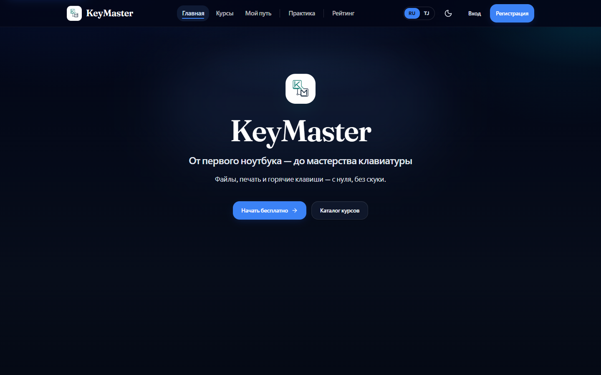

# KeyMaster — платформа для изучения горячих клавиш

**[Открыть демо / Live demo →](https://keymaster-liart.vercel.app)**

> 🔒 Это витрина проекта. Исходный код закрыт. Доступ к коду — по запросу: [Telegram](https://t.me/ravshanjonitolibjon) · [Email](mailto:ravg578@gmail.com)
> 🔒 This is a project showcase. Source code is private; access on request.

## 🇷🇺 О проекте

Обучающая платформа «от первого ноутбука до мастерства клавиатуры»: работа с файлами, печать и горячие клавиши Windows, VS Code, браузеров и IDE. Курсы, практика, личный путь обучения и рейтинг.

**Возможности**
- Каталог курсов и пошаговый «Мой путь»
- Практика с тренажёром горячих клавиш
- Рейтинг учеников
- Регистрация и вход (JWT), админ-панель
- Два языка (русский и таджикский), светлая и тёмная тема

## 🇬🇧 About

Learning platform for keyboard shortcuts (Windows, VS Code, browsers, IDEs): courses, practice trainer, personal learning path and leaderboard.

**Features:** course catalog and learning path · hotkey practice trainer · leaderboard · JWT auth and admin panel · RU/TJ · light/dark theme.

## Технологии / Tech stack

| | |
|---|---|
| Frontend | React, TypeScript, Vite, Tailwind CSS v4, Framer Motion, Zustand, TanStack Query |
| Backend | Python, FastAPI, SQLAlchemy (async), JWT |
| База данных | PostgreSQL |
| Deploy | Vercel, Railway, Docker |

---

Автор / Author: [Ravshanjon](https://github.com/Ravshanjon-developer) · © 2026. All rights reserved.
